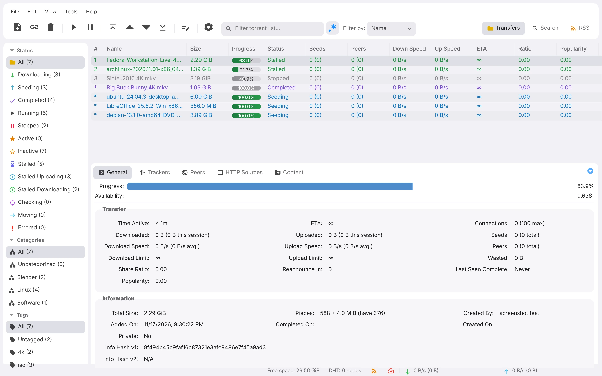
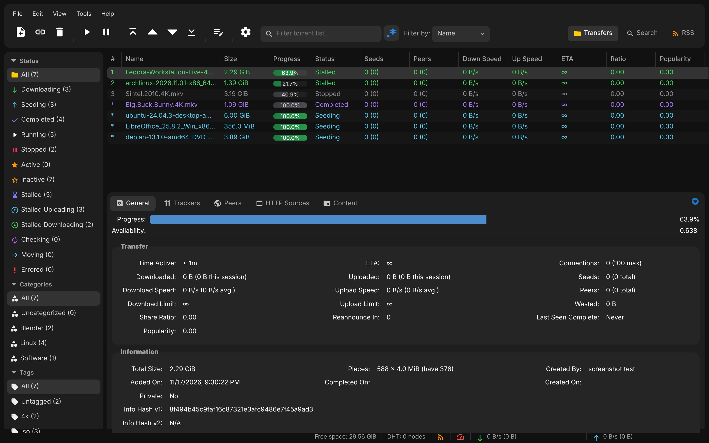
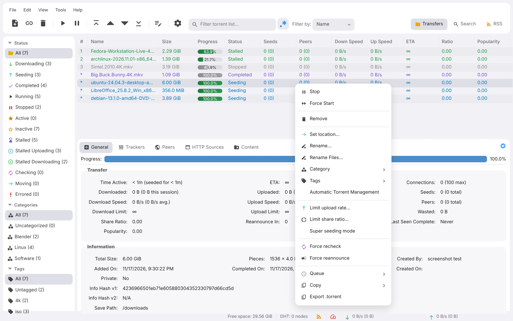
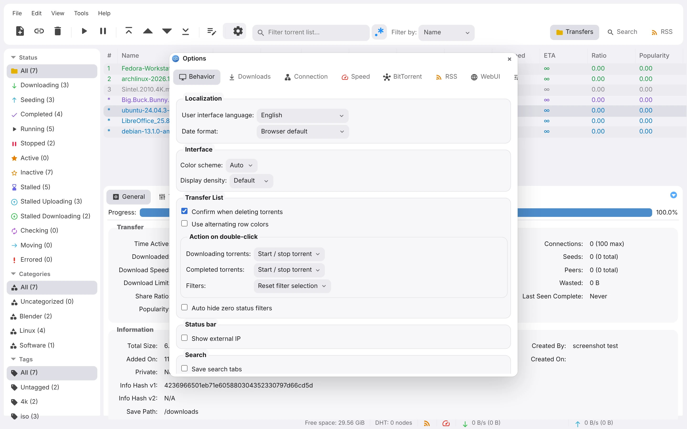
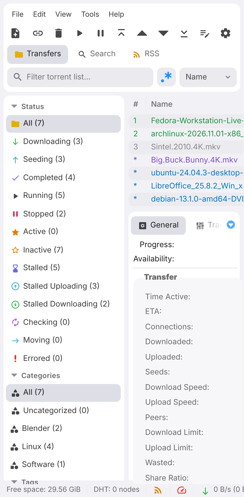
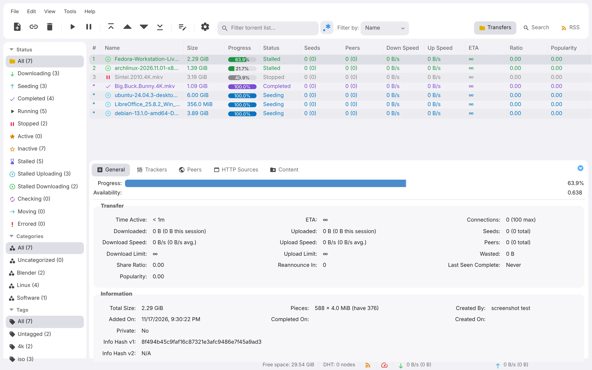
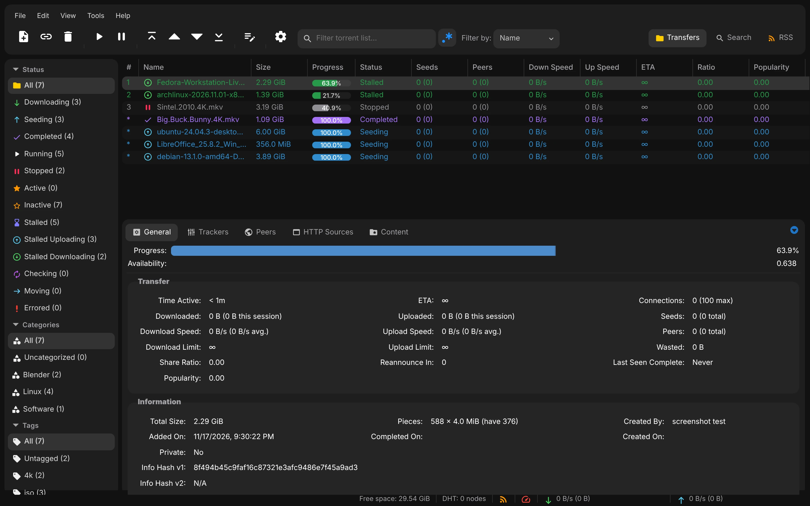

# Nightseed for the qBittorrent WebUI

Nightseed for people who run qBittorrent headless (in Docker, on a NAS or a
seedbox) and only ever see its WebUI in a browser. It follows the desktop theme
as closely as a browser allows: the menu bar and toolbar as one floating card,
the sidebar and details panel as cards on the dark canvas, pill-shaped
selections, the green gradient progress bars, the same colour-coded icons
(from `source/icons`) and rows coloured by torrent state. It also has a layout
for phones: a compact header, no permanent scrollbars and a one-column General
tab.

## Five versions

- **Nightseed** (`nightseed`): rows coloured by state, green gradient progress
  bars (grey when stopped or errored), no state icons.
- **Nightseed Alternative** (`alternative`): a state icon at the start of each
  row, and progress bars in each state's colour, with the darker green and blue
  of the desktop version.
- **Nightseed OLED** (`oled`): Nightseed on true black.
- **Nightseed Auto** (`auto`): Nightseed in dark mode, and a light design in
  light mode: white cards on a soft grey canvas, the same shapes and icons
  (the white ones turned dark grey) and the state colours deepened to read on
  white. It follows the WebUI's own **Options → Behavior → Color scheme**:
  *Auto* follows the device, *Light* and *Dark* fix it. The switch is instant,
  and each browser keeps its own choice.
- **Nightseed Alternative Auto** (`alternative-auto`): the same for
  Alternative: Nightseed Alternative in dark mode, and the light design with
  Alternative's state icons and state-coloured progress bars in light mode.

Nightseed, Alternative and OLED stay dark whatever the Color scheme setting
says.

<p align="center">
  <a href="../assets/originals/12-webui-light.png?raw=true"></a>
  <a href="../assets/originals/13-webui-dark.png?raw=true"></a>
</p>

<p align="center">
  <a href="../assets/originals/14-webui-light-menu.png?raw=true"></a>
  <a href="../assets/originals/15-webui-light-options.png?raw=true"></a>
</p>

<p align="center">
  <a href="../assets/originals/16-webui-light-mobile.png?raw=true"></a>
</p>

<p align="center">
  <a href="../assets/originals/17-webui-alternative-auto-light.png?raw=true"></a>
  <a href="../assets/originals/18-webui-alternative-auto-dark.png?raw=true"></a>
</p>

**Nightseed Transparent** has no WebUI version: it shows what's behind
qBittorrent's window, and a web page can't see past the browser.

## How it works

qBittorrent's *alternative WebUI* option swaps its whole WebUI for a folder of
files, and those files have to match the qBittorrent version that serves them.
So the theme doesn't ship a copy of qBittorrent's WebUI. Instead
`nightseed.sh` builds one:

1. It reads the qBittorrent version: from the linuxserver image's
   `/build_version`, or from `qbittorrent-nox --version`.
2. If the theme was built for a different version, style or theme, it
   downloads that release's source archive from
   [qbittorrent/qBittorrent](https://github.com/qbittorrent/qBittorrent), takes
   its WebUI (`src/webui/www`), adds the Nightseed stylesheet after the stock
   ones and swaps in the icons. Nothing from the download is run: the files are
   only served to the browser, like the built-in WebUI.
3. Otherwise it does nothing, so ordinary restarts cost nothing.

It builds into a new folder and swaps it in only when it's complete: if the
download fails, the current theme stays as it is.

With the [linuxserver/qbittorrent](https://docs.linuxserver.io/images/docker-qbittorrent/)
image the script runs at every container start, before qBittorrent, so the
theme rebuilds itself after an image update.

It's tested with qBittorrent 5.0, 5.1, 5.2 and 5.3. Older versions build their
WebUI too differently: they get the stock WebUI, so it keeps working, and the
theme comes back after an upgrade.

## Install

For the linuxserver/qbittorrent Docker image:

1. Download
   [**Nightseed-WebUI.zip**](https://github.com/Xtenso/qbittorrent-theme/releases/latest/download/Nightseed-WebUI.zip)
   from the latest release. It holds two folders.
2. Put `nightseed-src` in the folder you mount as `/config`, and
   `custom-cont-init.d` next to it (anywhere on the host works).
3. The image only runs start-up scripts owned by root:

   ```sh
   sudo chown -R root:root custom-cont-init.d
   sudo chmod 755 custom-cont-init.d/nightseed.sh
   ```

4. Mount the script folder in the container, for example in your compose file:

   ```yaml
   volumes:
     - /path/to/custom-cont-init.d:/custom-cont-init.d:ro
   ```

5. Recreate the container and check the build ran:
   `docker logs qbittorrent 2>&1 | grep nightseed`.
6. In the WebUI: **Tools → Options → WebUI**, tick **Use alternative WebUI** and
   enter `/config/nightseed`. Save and reload the page.

To build right away without restarting qBittorrent:
`docker exec qbittorrent bash /custom-cont-init.d/nightseed.sh`.

To go back to the stock WebUI, untick **Use alternative WebUI**.

## Choosing the version

The quickest way is the script's menu. It saves your choice and rebuilds straight away:

```sh
docker exec -it qbittorrent bash /custom-cont-init.d/nightseed.sh choose
```

Or give the version's name directly, without the menu:
`docker exec qbittorrent bash /custom-cont-init.d/nightseed.sh alternative-auto`.
Reload the WebUI page afterwards.

By hand: write `nightseed`, `alternative`, `oled`, `auto` or `alternative-auto` into
`nightseed-src/style` and restart the container (or run the script as above). The script rebuilds
`/config/nightseed` with that version; the WebUI path stays the same.

The container variable `NIGHTSEED_STYLE` does the same and wins over the file.
Rarely needed: `NIGHTSEED_SRC` and `NIGHTSEED_OUT` move the two folders
(defaults `/config/nightseed-src` and `/config/nightseed`).

## Without the linuxserver image

The script only needs a shell, `curl`, `tar` and `sha256sum`. Run it on the
qBittorrent host after each qBittorrent update, pointing it at your folders,
for example from a clone of this repository:

```sh
NIGHTSEED_SRC=webui NIGHTSEED_OUT=/path/to/nightseed NIGHTSEED_STYLE=oled sh webui/nightseed.sh
```

In a clone it takes the icons from `source/icons`.

## Known limitations

- **Piece bars** (the *Progress* and *Availability* bars on the General tab):
  the WebUI draws them with a script in fixed colours, so they stay blue and
  green. Their corners are rounded.
- **Colour scheme**: only the two Auto versions follow the WebUI's Color
  scheme setting. Their login page follows the device instead, because the WebUI can't
  read your settings before you log in.
- **Future qBittorrent versions** may change the WebUI enough to need a theme
  update. The WebUI keeps working either way.
- **Cached files**: the stylesheet's address changes with every build, so
  browsers fetch the new one. Icons can stay cached after the first switch to
  the theme: clear the site's cached data once if the old icons show.
